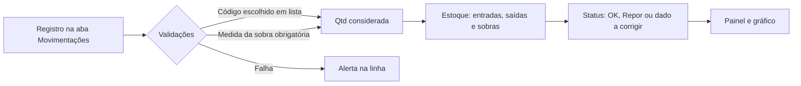

# Controle de Estoque e Sobras de Material

Planilha de controle de estoque com **entradas, saídas, sobras de material, alertas automáticos e painel**, pensada para operações que instalam ou aplicam produtos em campo e precisam saber, a qualquer momento, o que está lacrado, o que sobrou e o que precisa ser reposto.

> **Aviso:** todos os dados deste repositório são **fictícios** (produtos, fornecedores e responsáveis). Nenhuma informação real de empresa ou cliente foi publicada.

## O problema

Em operações com vários instaladores e fornecedores, o controle de estoque costuma falhar por detalhes pequenos:

- o mesmo **código repetido** em dois produtos, e as movimentações de um caem no outro;
- **linhas sem fórmula** depois de copiar e colar, e a movimentação deixa de ser contada;
- **espaços extras** ou letras trocadas no código, e a busca não encontra o produto;
- **sobras de material** (fração de kit que volta da obra) lançadas de forma solta, sem entrar no saldo;
- **saldo de sobra negativo**, quando sai mais do que existe, sem ninguém perceber;
- totais que **misturam kits com acessórios** (baldes, pincéis, rolos), o que distorce os números.

## A solução

Uma planilha em que **tudo parte de um único registro de movimentações**. O estoque, os alertas e o painel são calculados sozinhos a partir dele.

| Aba | Para que serve |
|---|---|
| **Painel** | Indicadores, quadro por fornecedor e gráfico de saldo por produto |
| **Como usar** | Legenda, regras e premissas |
| **Estoque** | Cadastro dos produtos e saldos calculados, com status de cada item |
| **Movimentações** | Registro de entradas, saídas e sobras |
| **Listas** | Opções das listas suspensas e a fração de cada medida de sobra |

## Como o fluxo funciona



## Regras que evitam os erros

1. **Um código identifica um único produto.** A aba Estoque bloqueia código repetido na digitação e marca "Código duplicado" caso apareça.
2. **O código é escolhido em uma lista**, nunca digitado. Assim não existe espaço extra nem letra errada.
3. **Sobras de kit são lançadas por medida** (1/4, 1/2, 3/4 ou 1 kit) e convertidas em fração do kit pela aba Listas.
4. **Saldo de sobra negativo gera alerta.** O status do produto muda e o Painel conta o problema.
5. **Fórmulas prontas até a linha 505** de Movimentações, para não perder cálculo ao colar dados.
6. **Kits e acessórios são somados separadamente** no Painel.

## Status do estoque

| Status | Significado |
|---|---|
| OK | Saldo acima do estoque mínimo |
| Repor | Saldo igual ou abaixo do mínimo cadastrado |
| Código duplicado | Dois produtos com o mesmo código |
| Saldo de sobras negativo | Saíram mais sobras do que entraram |
| Saldo lacrado negativo | Saíram mais unidades do que entraram |

## Ferramentas e técnicas

- Excel / Google Sheets
- `SUMIFS`, `COUNTIF`, `INDEX` e `MATCH`, `VLOOKUP`, `IFERROR`
- Validação de dados (listas suspensas e regra personalizada)
- Formatação condicional para alertas
- Painel com gráfico de barras
- Mapeamento do fluxo de dados em Mermaid

## Como usar

1. Baixe `planilha/Controle_de_Estoque_Modelo.xlsx`.
2. Em **Estoque**, cadastre seus produtos nas linhas 6 a 45 (código, fornecedor, produto, tipo e estoque mínimo).
3. Em **Movimentações**, registre cada entrada, saída, retorno de sobra e saída de sobra.
4. Acompanhe o **Painel** e os alertas.

Células amarelas com texto azul são para preencher. Células cinza têm fórmula e não devem ser editadas.

## Como testar os alertas

- Tente cadastrar um código que já existe em Estoque: a planilha bloqueia.
- Lance uma "Saída de sobra" maior que o saldo de sobras de um produto: o status vira "Saldo de sobras negativo".
- Lance uma sobra sem escolher a medida: a coluna Alerta mostra "Escolha a medida da sobra".

## Estrutura do repositório

```
estoque-sobras/
├── README.md
├── planilha/
│   └── Controle_de_Estoque_Modelo.xlsx
└── docs/
    └── (prints do painel e do fluxo)
```

## Aprendizados

- Um registro único de movimentações é mais confiável do que vários saldos digitados à mão.
- Validar o dado na entrada evita mais erro do que corrigir depois.
- Separar kits de acessórios deixa os indicadores honestos.

## Próximos passos

- Alerta de estoque baixo por e-mail.
- Indicador de consumo médio por semana e por responsável.
- Versão em Power BI conectada à planilha.

## Autora

**Laiana Paganelli** · Processos, Operações e Customer Success
[LinkedIn](https://www.linkedin.com/in/laianapaganelli/)
